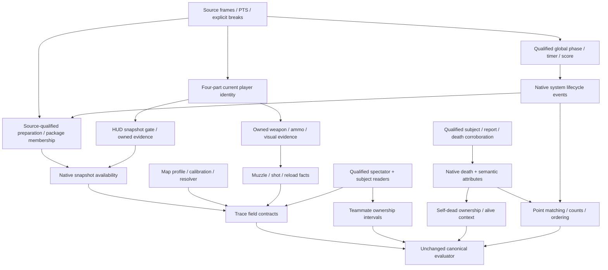

# Current full-candidate failure classification

## Problem and evidence

This analysis uses the normally completed Strict native-replay full candidate and its confidence-normalized canonical trace. It is **not an adopted baseline update**. HEAD is `c11ec6d333957cccb270417bc95a8a57f433e6ad` with uncommitted implementation changes. No new video recognition or full E2E ran for this analysis. The unchanged reference evaluator was replayed and its entire failure list matched the saved evaluation exactly.

| Metric | Adopted previous | Current candidate | Delta |
| --- | ---: | ---: | ---: |
| PASS | 23 | 28 | +5 |
| FAIL | 55 | 50 | -5 |
| NOT_EVALUATED | 4 | 4 | 0 |
| Round starts | 0 | 2 | +2 |
| Round ends | 0 | 1 | +1 |
| Native packages | 1 partial | 2 | +1 |
| Negative failures | 0 | 0 | 0 |
| Discontinuity violations | 0 | 0 | 0 |

The new PASS IDs are `GT-R1-ROUND-START`, `GT-R2-ROUND-START`, `event_count_constraints-000`, `event_count_constraints-002`, and `event_count_constraints-004`. No formerly passing assertion regressed. Canonical overall pass remains false. Private paths and all relevant raw/trace/assertion/evaluator/builder/adapter hashes are recorded in the JSON. The original adopted 82-row matrix remains unchanged.

## Root cause summary

Each FAIL is assigned once to its **first observed blocker**, not to a proven sole cause. Secondary predicates remain mandatory. Counts do not measure the independent number of assertions guaranteed to pass after one change.

| Root cause | FAIL | Share of 50 | Implementation class | Conditional primary ceiling |
| --- | ---: | ---: | --- | ---: |
| snapshot_hud_gate | 17 | 34.0% | upstream dependency | +17 |
| preparation_scope | 9 | 18.0% | upstream dependency | +9 |
| death_event_contract | 4 | 8.0% | partial implementation | +4 |
| remote_state | 4 | 8.0% | recognition failure | +4 |
| owned_visual_evidence | 4 | 8.0% | upstream dependency | +4 |
| self_ownership | 2 | 4.0% | upstream dependency | +2 |
| dead_ownership | 2 | 4.0% | partial implementation | +2 |
| round_end_time | 1 | 2.0% | partial implementation | +1 |
| smoke_state | 1 | 2.0% | recognition failure | +1 |
| expanded_map_state | 1 | 2.0% | partial implementation | +1 |
| spectator_coverage | 1 | 2.0% | recognition failure | +1 |
| teammate_ownership | 1 | 2.0% | upstream dependency | +1 |
| killfeed_export | 1 | 2.0% | missing implementation | +1 |
| ammo_reload_contract | 1 | 2.0% | partial implementation | +1 |
| spectator_snapshot_contract | 1 | 2.0% | partial implementation | +1 |

For every single-root fix the presently **proven guaranteed gain is zero**. The ceilings are disjoint membership counts, not forecasts. Summing them would require all source evidence, association, identity, field and temporal predicates to succeed.

| Implementation class | FAIL | Share |
| --- | ---: | ---: |
| partial implementation | 10 | 20.0% |
| upstream dependency | 33 | 66.0% |
| recognition failure | 6 | 12.0% |
| missing implementation | 1 | 2.0% |

## Snapshot findings

The largest first-blocker cluster is `snapshot_hud_gate`: **17/50 (34%)**. Sixteen required snapshots and one derived assertion are inside the correct package, have main frames within their fixed tolerance, but have **zero** such main frames meeting the unchanged HUD confidence 0.65 snapshot gate. This is not evidence of decode omission, sparse snapshot deduplication, an evaluator defect, or a geometry-only cause. All these main frames are classified unknown. The builder has no eligible snapshot to serialize at those times.

Three other required snapshots and two derived assertions have targets outside package preparation: R1 3.5 s and R2 82/105 s. Their local main frames also fail the snapshot gate. Membership correction alone cannot make them pass. The three existing failing snapshots are different: 47.5 s lacks nonself killfeed visibility; 72.8 s lacks ammo and reload semantics; 170 s has spectator state but lacks death, subject identity, numbers, weapon, location and muzzle facts.

No `nonself_killfeed_row_visible`, `reload_animation_visible`, `muzzle_flash_visible`, or `spectated_name` semantic export is currently present in the searched production/trace code. Native models/readers for adjacent facts are not equivalent to these contracts. Full output has **zero structured killfeed rows and zero combat-report field-reading observations**. These values must not be supplied from GT.

## Preparation and source boundaries

Strict package windows are R1 `[3.602669, 81.752669]` and R2 `[110.986003, 171.019336]`, with an open R2 end. The **9** preparation blockers comprise two buy-phase intervals, two R2 menu intervals, three required snapshots and two derived snapshots. This replaces the historical 29-row round-package cluster; R2 active/post-death assertions now have a package and fail other predicates.

Buy-phase coverage is only **11.7235%** for R1 and **1.4082%** for R2. Both R2 menu intervals have 0% round-scoped coverage. Source breaks at 81.786003 and 81.836003 must remain explicit. The existing Practical unknown-fragment mechanism can preserve the omitted observations but cannot by itself prove their R2 membership or ownership. Do not bridge the break or copy GT IDs.

## Recognition and ownership

All four Astra intervals, smoke and expanded-map intervals have **0%** matching canonical state coverage. A remote/texture path exists, but qualified interface evidence is insufficient; expanded-map texture is explicitly only a candidate. Spectator coverage is **29.1533%**, below 90%. Self coverage is R1 **8.9225%**, R2 **5.7927%**; teammate coverage is **28.4423%**. Both self-dead intervals are 0% and lack a producer-to-trace ownership path. These are coverage ratios from interval unions, not unknown totals or accuracy measurements.

Fresh geometry remains 1 while effective geometry covers all 6614 main frames. This trace does not prove that retained geometry causes any single FAIL. Do not infer causation from those two counts or change its acceptance policy.

## Round / death / visual / map

R1 round end exists at **74.486003**, after the score change, but misses the fixed strict window ending 74.483 by **0.0030026 s**. Later result corroboration at 75.369336 is retained separately. Clock drop at 74.452669 and an early visually reviewed result flash are diagnostic evidence; neither authorizes choosing the timestamp closest to GT. No R2 end exists.

Death contributes **4 exclusive FAIL**: two required death points and their two count constraints. Existing temporal death code needs report plus independent self-death corroboration; its attributes only emit cause-known semantics, not all required victim/agent/damage facts. A report can remain open after respawn. Fixing attributes without identity/temporal evidence cannot manufacture a death.

All four ordering assertions are NE because one or both required matched points are absent: R1 start→death, start→end, death→end, and R2 start→death. A source-correct R1 end could conditionally yield **+1 FAIL→PASS and +1 NE→PASS** (candidate 30/49/3), but is not yet proven. Source-correct deaths could conditionally yield +4 primary PASS and unlock two orderings with already passing starts; the death→end ordering also needs a matched end. These are separate conditional sets and must not be double-counted.

Three muzzle observations plus one shot count contribute **4** upstream visual FAIL. Their main source windows have no HUD-eligible frames; no accepted player-owned shot/muzzle exists. The one emitted visual event is stationary movement, not a shot. Map-derived assertions remain blocked first by absent snapshots; map resolution is an additional unresolved dependency, not something package splitting solves.

## Actual dependency graph

## Recommended priority and next implementation task

1. **Snapshot producer evidence audit and source-backed field transport.** Freeze the 17 inside-package targets below. Distinguish qualified global facts from player-owned facts at each actual frame. Investigate whether the existing single HUD gate discards qualified global observations; retain independently qualified facts without marking identity, ownership, alive, ammo or HP valid. Add regression tests for unknown identity and negative controls before any field-specific path. This directly addresses the largest current first blocker; its +17 ceiling is not a promise of 17 PASS because all original owned/state predicates remain required.
2. **Death/subject/event contract**, reusing the existing prospective report/localization diagnostics. Bind victim, killer and damage to independently established self-death, not the global lifecycle route. Track the four primary death FAIL and two already-started ordering opportunities. Continue to reject persisted-report and spectator/menu negatives. Do not repeat failed bare-string or unqualified portrait experiments.
3. **Preparation context retention and explicit association.** Preserve prefix/inter-round unknown fragments with the existing Practical mode; establish membership from source lifecycle evidence without crossing the recorded breaks. Track the nine primary blockers plus their snapshot/owned/map secondary dependencies.
4. **Targeted state coverage and remaining semantic exports**, then map and owned visual pipelines. Qualified spectator continuity is independently needed for its interval and teammate ownership. Unknown reduction is never the selection KPI.

R1 end timing remains a separately bounded semantic investigation. Its possible +2 metric movement is smaller than the above clusters and must not become a repeated GT-fitting exercise. No new timer/score/result threshold candidate is justified by this classification.

## Milestones and verification

First checkpoint: replay all 82 unchanged canonical predicates after each contract-only change and preserve the 28 current candidate passes and all 20 negative passes. Recognition changes require fresh code/profile-bound component validation; do not re-sign prior qualification. Independent numeric review and Linux/Windows integration remain adoption gates.

Conditional timing checkpoint: 30 PASS / 49 FAIL / 3 NE only after independent end-time semantics prove the detected point. Conditional death checkpoint from the current candidate: 34 PASS / 46 FAIL / 2 NE if both full death predicates and the two start→death orderings hold; with a separately correct end, 36 PASS / 45 FAIL / 1 NE, then death→end may additionally evaluate. These are predicate-based scenarios, not adopted results or guarantees. No numeric milestone is assigned to the 17 snapshot targets until required owned/state facts are established.

Analysis checks: unique 82 IDs; exclusive 50 FAIL assignments; status counts 28/50/4; exact unchanged evaluator failure-list equality; all missing snapshot windows have actual main observations and zero gate-eligible main observations; assertion/evaluator hashes recorded. No thresholds, GT, ownership, sampler, event behavior, confidence or validation semantics were modified. No new full E2E; no push. Full regression after the earlier trace-confidence change and current-branch Windows CI remain unverified.

## 82 assertion matrix

| Assertion | Adopted previous | Current | First blocker |
| --- | --- | --- | --- |
| GT-R1-ROUND-START | fail | pass | — |
| GT-R1-DEATH | fail | fail | death_event_contract |
| GT-R1-ROUND-END | fail | fail | round_end_time |
| GT-R2-ROUND-START | fail | pass | — |
| GT-R2-DEATH | fail | fail | death_event_contract |
| ordering_constraints-000 | ne | not_evaluated | unmatched point dependency |
| ordering_constraints-001 | ne | not_evaluated | unmatched point dependency |
| ordering_constraints-002 | ne | not_evaluated | unmatched point dependency |
| ordering_constraints-003 | ne | not_evaluated | unmatched point dependency |
| GT-R1-BUY-FLAG | fail | fail | preparation_scope |
| GT-R1-ASTRAL-1 | fail | fail | remote_state |
| GT-R1-ASTRAL-2 | fail | fail | remote_state |
| GT-R1-SMOKE | fail | fail | smoke_state |
| GT-R1-COMBAT-REPORT | pass | pass | — |
| GT-R2-BUY-FLAG | fail | fail | preparation_scope |
| GT-R2-BUY-MENU-1 | fail | fail | preparation_scope |
| GT-R2-BUY-MENU-2 | fail | fail | preparation_scope |
| GT-R2-ASTRAL-1 | fail | fail | remote_state |
| GT-R2-ASTRAL-2 | fail | fail | remote_state |
| GT-R2-EXPANDED-MAP | fail | fail | expanded_map_state |
| GT-R2-SPECTATOR | fail | fail | spectator_coverage |
| OWN-R1-SELF | fail | fail | self_ownership |
| OWN-R1-SELF-DEAD | fail | fail | dead_ownership |
| OWN-R2-SELF | fail | fail | self_ownership |
| OWN-R2-SELF-DEAD | fail | fail | dead_ownership |
| OWN-R2-TEAMMATE | fail | fail | teammate_ownership |
| GT-R1-SNAP-0035 | fail | fail | preparation_scope |
| GT-R1-SNAP-0415 | fail | fail | snapshot_hud_gate |
| GT-R1-SNAP-475 | fail | fail | killfeed_export |
| GT-R1-SNAP-585 | fail | fail | snapshot_hud_gate |
| GT-R1-SNAP-595 | fail | fail | snapshot_hud_gate |
| GT-R1-SNAP-705 | pass | pass | — |
| GT-R1-SNAP-728 | fail | fail | ammo_reload_contract |
| GT-R1-SNAP-733 | fail | fail | snapshot_hud_gate |
| GT-R1-SNAP-734 | fail | fail | snapshot_hud_gate |
| GT-R1-SNAP-7425 | fail | fail | snapshot_hud_gate |
| GT-R1-SNAP-7438 | fail | fail | snapshot_hud_gate |
| GT-R1-SNAP-7440 | fail | fail | snapshot_hud_gate |
| GT-R1-SNAP-7445 | fail | fail | snapshot_hud_gate |
| GT-R2-SNAP-820 | fail | fail | preparation_scope |
| GT-R2-SNAP-1050 | fail | fail | preparation_scope |
| GT-R2-SNAP-11145 | fail | fail | snapshot_hud_gate |
| GT-R2-SNAP-143 | fail | fail | snapshot_hud_gate |
| GT-R2-SNAP-1475 | fail | fail | snapshot_hud_gate |
| GT-R2-SNAP-1476 | fail | fail | snapshot_hud_gate |
| GT-R2-SNAP-1477 | fail | fail | snapshot_hud_gate |
| GT-R2-SNAP-149 | fail | fail | snapshot_hud_gate |
| GT-R2-SNAP-151 | fail | fail | snapshot_hud_gate |
| GT-R2-SNAP-170 | fail | fail | spectator_snapshot_contract |
| GT-R1-SNAP-0035-DERIVED-zone_id | fail | fail | preparation_scope |
| GT-R1-SNAP-0415-DERIVED-zone_id | fail | fail | snapshot_hud_gate |
| GT-R2-SNAP-820-DERIVED-zone_id | fail | fail | preparation_scope |
| GT-R1-MUZZLE-1 | fail | fail | owned_visual_evidence |
| GT-R1-MUZZLE-2 | fail | fail | owned_visual_evidence |
| GT-R1-MUZZLE-3 | fail | fail | owned_visual_evidence |
| event_count_constraints-000 | fail | pass | — |
| event_count_constraints-001 | fail | fail | death_event_contract |
| event_count_constraints-002 | fail | pass | — |
| event_count_constraints-003 | fail | fail | owned_visual_evidence |
| event_count_constraints-004 | fail | pass | — |
| event_count_constraints-005 | fail | fail | death_event_contract |
| event_count_constraints-006 | pass | pass | — |
| NEG-REMOTE-R1A | pass | pass | — |
| NEG-REMOTE-R1B | pass | pass | — |
| NEG-REMOTE-R2A | pass | pass | — |
| NEG-REMOTE-R2B | pass | pass | — |
| NEG-ASTRAL-NOT-SMOKE | pass | pass | — |
| NEG-SMOKE-NOT-ASTRAL | pass | pass | — |
| NEG-SMOKE-WORLD-SPOT | pass | pass | — |
| NEG-NONSELF-KILLFEED | pass | pass | — |
| NEG-RELOAD-NOT-SHOT | pass | pass | — |
| NEG-BUY-MENU-1 | pass | pass | — |
| NEG-BUY-MENU-2 | pass | pass | — |
| NEG-SPECTATOR-COUNT-TEXT | pass | pass | — |
| NEG-DEAD-PLAYER-MECHANICS | pass | pass | — |
| NEG-EXPANDED-MAP-MECHANICS | pass | pass | — |
| NEG-SPECTATOR-POISON-151 | pass | pass | — |
| NEG-SPECTATOR-POISON-170 | pass | pass | — |
| NEG-STALE-COMBAT-REPORT | pass | pass | — |
| NEG-R2-NO-ROUND-END | pass | pass | — |
| NEG-SAME-ZONE-CALLOUT-CHANGE | pass | pass | — |
| NEG-CONTENT-JUMP-SPAN | pass | pass | — |

Machine-readable definitions, actual values/coverage/PTS, reasons, secondary dependencies and hashes: [current_failure_classification.json](../e2e_reports/match_001/current_failure_classification.json).

Pre-push verification: 212 related tests PASS in 170.65 seconds; Ruff PASS; mypy 131 source files PASS. The adopted 82-row matrix is exactly equal to HEAD. No full E2E was repeated for publication. Remote main advanced to becc9eb (L5 storage/display separation); integration validation is recorded below when completed.
