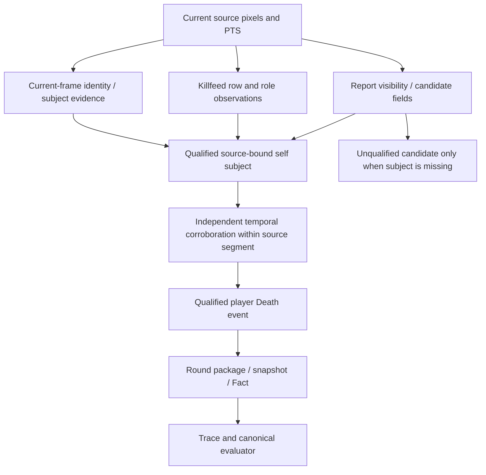

# S-01 follow-up: subject-bound Death evidence

## Decision and scope

**B: source-backed safety repair, positive Death recognition still unqualified.** This is a separate follow-up to PR #44. It does not turn report presence, spectator state, global timer/score or damage candidates into self life/death evidence. Adopted Full remains 23/55/4; the previous unadopted Full is 28/50/4. No new canonical PASS is claimed.

## Actual dependency chain



Report visibility establishes that a panel is displayed. Its continued presence does not establish a new death, because it can remain open after respawn. A report portrait or damage number is not a killer/victim/self binding. A killfeed row requires separately established killer and victim roles and source-player identity before it can identify self death. Spectator detection establishes the current view context, not the original player's life state. None can replace the other prerequisites.

The original Full has **zero structured killfeed readings** and **zero combat-report field-reading observations**. The configured report reader path in `RealHudAnalyzer` can export source-bound `status=candidate` fields; its schema does not certify player ownership or death. Existing report-header negative controls remain unchanged. An authoritative self-subject model would require a separately reviewed contract/qualification task; none is invented here.

## Implementable defect and minimal repair

`HudDirectEventBuilder.build()` already computes `current_player_hud_valid` using `_player_hud_is_valid()`: `primary_state == live_first_person` and an explicit boolean `player_specific_hud_valid is True`. Ability/status and other owned paths use this predicate. The legacy `_player_death_event()` caller omitted it. A visible persistent report combined with `spectator_transition`, `self_hud_identity_lost` or `roster_self_dead` could therefore emit `actor=player` while the current observation was explicitly unowned.

The only production change adds `or not current_player_hud_valid` to that caller's existing pre-round/start guard. It enforces an existing ownership predicate; it changes no schema, confidence interpretation, threshold, identity criterion, actor vocabulary, qualification pack or lifecycle policy. The helper's existing positive owned path and duplicate latch are unchanged. There is no actor rewrite and no substitution of global evidence for player evidence.

This is a restriction of an unsafe path, not a new positive Death producer. In the measured report/death-transition frames, identity is unqualified, so the path correctly remains silent. Independently qualified subject evidence is still needed to solve the positive Death assertions.

## Synthetic regression

Before the repair, seven high-confidence unowned cases failed the negative test and the existing owned positive passed (7 FAIL / 1 PASS). After the repair, all pass. Cases include unknown, spectator, remote, explicit nonowned live view, contradictory unknown+owned flag, missing flag and numeric `1` instead of boolean true. Observation mutation is checked. A separate persistent-report state-jitter test checks unknown → spectator → unknown → spectator without creating self death.

Related Death/report/ownership tests: **79 PASS, 20.98 s**. Additional transport/package/Strict-Practical/integration selection: **127 PASS, 123.40 s**. These synthetic outcomes are not reported as real-video accuracy or new canonical PASS.

## Fresh source-continuous negative validation

Each window was decoded as contiguous native frames at original PTS. The explicit SHA-bound unedited contract allowed only the existing geometry prefix. Native-prefix processing was measurement-only (`_build_events=False`); that safety restriction was not bypassed. Source hash, pixel hashes, profile and terminal code fingerprint were preserved. The before/after comparison calls the old and repaired event producers on the same **fresh current-code observations**, deriving spectator transitions from adjacent measured primary states using the existing production rule. It is an offline producer comparison, not a formal runtime event release or a newly qualified recognizer.

| Source window | Native frames | Old unowned self Death | Repaired | Delta |
|---|---:|---:|---:|---:|
| 74.25–74.65, report appearance | 24 | 0 | 0 | 0 |
| 147.35–147.85, second appearance | 30 | 0 | 0 | 0 |
| 104.0–104.4, persistent report | 24 | 0 | 0 | 0 |
| 169.8–170.2, spectator/report control | 24 | 1 | 0 | -1 |
| Total | 102 | 1 | 0 | -1 |

The old false candidate at **169.836003** was `player_death`, `actor=player`, confidence 0.85, during explicitly unowned spectator/report observations. It is suppressed by the repaired caller. This does **not** imply that the existing Full had a false Death: its sampler/latch/history differs and its negative assertions already passed. No new formally qualified owned Death was emitted.

The two report-appearance windows still lack a qualified self subject/temporal life transition. At 170.002669, a panel is positively recognized and the visually inspected image shows a spectated view with a persistent report. Visible firing there belongs to the viewed subject and is not evidence of self firing or new self death. Player life remains unknown.

## Global qualification compatibility

The one-condition source change moves the broad recognizer fingerprint from `ad482fe1bae0f2c4401ce0364841f749f63c6e2230ff75c49cf853962c8eb859` to `6ea410098baf11bbea9df5301ed901373a025e25023c220e1db6a3c01103a6fc`. The old qualification is not silently accepted or re-signed.

All 11 frozen component review stages were actually rerun against current production calls on source/pixel-hash verified images, preserving the original development/review/negative splits and their historical exposure. Runtime: **993.75 s**. The loader admitted the six-component offline candidate (`timer`, `purchase_phase`, `ui_transition`, `score`, `round_result`, `ui_end_transition`). Score review: 36 correct / 18 unknown / 0 wrong fields and 0 negative false-positive fields. Result review: 3 correct / 8 unknown / 0 wrong / 0 negative false positives. End controls produced zero patterns in both 27- and 72-frame windows; physical split intersections were empty.

This is **component admission**, not new blind temporal qualification, full lifecycle adoption or self-death qualification. The end review still describes one known end episode, not six independent ends. No default qualification was installed, no formal events were released and no profile assets were published. The exact current private candidate hash is recorded in the machine-readable report.

## Runtime, resources and reproducibility

| Measurement | Wall time |
|---|---:|
| 24 isolated source frames, before | 429.30 s |
| Same 24 source frames, repaired code | 427.77 s |
| 102 continuous source frames | 323.02 s |
| Frozen component review, 11 stages | 993.75 s |

The small isolated runtime difference is a measurement, not a claimed speed improvement. Peak RAM, CPU and swap were not measured. Private artifact bytes are recorded in the JSON; images, GT definitions, profiles and raw subject text are excluded from Git.

The reusable diagnostic is `scripts/diagnostics/inspect_identity_source.py`. Run from the selected checkout with its `src` first on `PYTHONPATH`; pass explicit video, profile, templates, input contract and a frozen reservation containing source SHA-256, native step ticks and `targets` with `id`, `role`, `source_pts_sec`. The reservation contains selectors only, never expected values. Use a new output directory. Optional qualification is checked through the explicit native input contract, never installed as sampled runtime authority. Output is private and isolated measurements do not attest continuity.

```bash
PYTHONPATH=src:. python3 scripts/diagnostics/inspect_identity_source.py \
  --video "$VIDEO" --profile "$LAYOUT" --templates "$TEMPLATES" \
  --input-contract "$INPUT_CONTRACT" --reservation "$RESERVATION" \
  --output "$NEW_PRIVATE_OUTPUT"
```

## Remaining blockers and next implementation

The five life assertions, four Death assertions and two dead-ownership assertions still need independently qualified source-player subject and life-transition evidence; the safety restriction cannot supply those facts. Current-state failures also retain per-field semantic blockers. See [the 50-row matrix](s01_semantic_evidence_root_cause_matrix.md) and [state measurements](state_identity_source_investigation.md).

The next producer task should first qualify subject/identity support on frozen source cohorts, including report persistence after respawn, nonself killfeed, spectator transitions, remote views and source breaks as explicit negatives. Any new subject schema or identity criterion requires impact analysis and approval before implementation. No additional video is made a blanket prerequisite; first identify which unseen roles/views are absent from the available reviewed material. Do not launch a Full until a positive semantic hypothesis survives fresh continuous and fixed sampled checks.

## CI and publication

At source commit `4e6e02d86a9e8bb8133292832a838b0e93639cef`, [Linux CI](https://github.com/shark-man0/eval_valorant_perspective/actions/runs/38734049976) completed successfully: **3782 PASS / 7 existing skips**, coverage **86.62%**, pytest 912.83 s. [Windows CI](https://github.com/shark-man0/eval_valorant_perspective/actions/runs/38734049969) completed successfully: **3778 PASS / 11 existing skips**, coverage **86.58%**, pytest 1082.37 s. Both validate the 38 dataset fixtures and pass Ruff/mypy. Windows additionally passes 13 UTF-8-disabled tests, PyInstaller and packaged application smoke. The processes exited normally, including the existing Qt shutdown coverage; other interactive GUI/video workflows are not newly attested. No test was skipped or weakened by this change.

The reports/JSON were updated after these completed runs; production and test code remain byte-identical to that CI-tested source commit. The separate stacked Draft [PR #46](https://github.com/shark-man0/eval_valorant_perspective/pull/46) targets the S-01 branch, preserving [PR #44](https://github.com/shark-man0/eval_valorant_perspective/pull/44)'s transport-only scope. Neither PR is merged into main.
